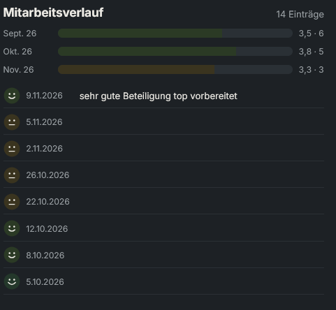
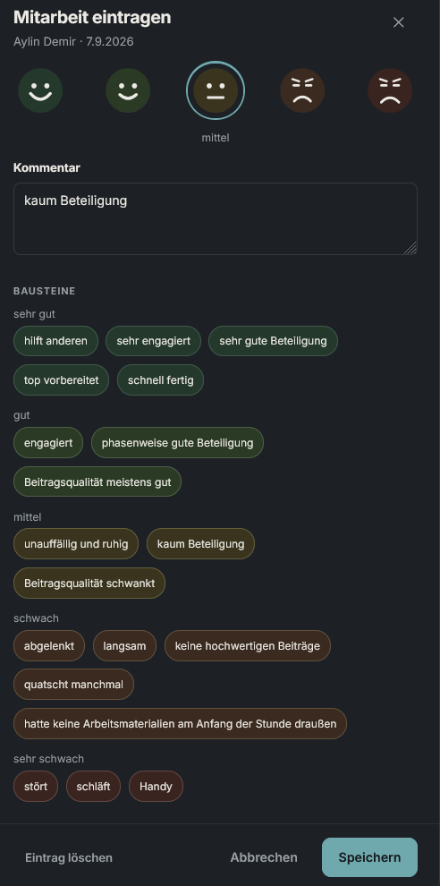
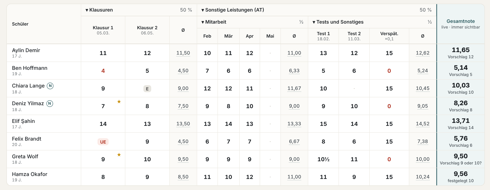
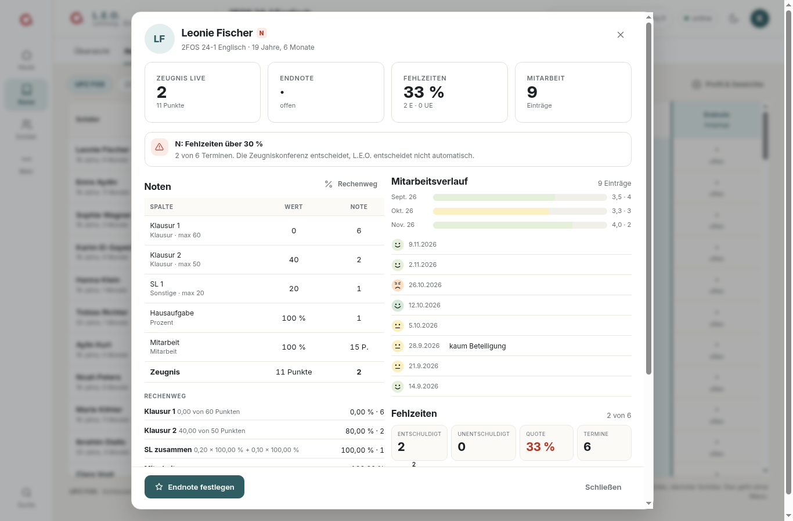
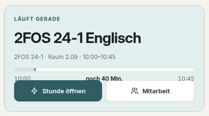

# Prototyp-Feedback vom 09.11.2026 (L.E.O. 0.3)

Rückmeldung von Konstantin zum SvelteKit-Prototyp (Version 0.3, statischer Build, nur erfundene Demo-Daten). Quelle ist eine 11-seitige Zusammenfassung vom 09.11.2026 ([Original-PDF](2026-11-09-original.pdf)), erstellt für den Umsetzungsagenten. Dieses Dokument überträgt den Inhalt ins Repo.

**So ist es aufgebaut**
- **Zitat** (Block mit `>`): wörtlich von Konstantin. Das PDF merkt an, dass die Zitate sprachlich leicht geglättet sind.
- **Antwort / Stand**: Beschreibung des Prototyps aus dem PDF (kein Zitat, keine Anforderung).
- **Abgeleitet**: Umsetzungshinweise, die aus den Zitaten gefolgert wurden. Sie sind **keine bestätigten Anforderungen**, solange sie nicht in [ENTSCHEIDUNGEN.md](../ENTSCHEIDUNGEN.md) stehen.

**Was daraus geworden ist:** Entscheidungen E65–E71 in [ENTSCHEIDUNGEN.md](../ENTSCHEIDUNGEN.md), Backlog-Einträge PF1–PF22 in [BACKLOG.md](../BACKLOG.md), die 11 offenen Fragen in [FRAGEN_SCHULE.md](../FRAGEN_SCHULE.md) (Abschnitt „Notenbuch-Modulplanung“).

**Rahmen (nach Projektregel Modulplanung):** Das Feedback wird pro Modul geplant, noch nicht umgebaut. Der Prototyp liegt beim Umsetzungsagenten (Branch `prototyp`, Schreibzugriff nur durch uns). In diesem Repo ändert sich dazu kein Code. Die Priorisierung im PDF (Abschnitt 10) ist ein Vorschlag des PDF-Autors und nicht von Konstantin bestätigt.

Screenshots 1 bis 3 stammen von Konstantin, 4 und 5 aus dem Prototyp (Demo-Zeit 10:05). Alle Namen und Werte darin sind erfunden. Die Bilder liegen in [bilder/](bilder/).

---

## Zusammenfassung (die wichtigsten Punkte laut PDF)

1. **Live-Stunde:** Mitarbeit und Anwesenheit auf einer Seite funktionieren „super“. Doppelklick auf das Smiley soll die Textbausteine öffnen. Gewünscht: Lernstoff-Kachel und „Übergang in die nächste Stunde“.
2. **Notenbuch:** Einzelleistungen als ganze Note oder Notenpunkte, nicht als Punkte von einem Maximum. Referenz ist das frühere Notenbuch (Screenshot 3).
3. **Mitarbeit:** Übersicht verdichten, Durchschnitt auf Notenskala 1 bis 5, Monatsnote mit Monatsauswahl, „Alle übernehmen“, Haken und Stift.
4. **Schülerkarte:** Design und Mitarbeitsverlauf bleiben. Rechenweg und Endnote oben entfallen. Stattdessen ein einseitiger PDF-Report.
5. **Fehlt:** Leistungen anlegen und bearbeiten, Kalender, Raumplan, Historie mit gesperrten alten Noten.
6. **Smileys:** Artstyle zu expressiv, ruhigere Variante wird geprüft.

---

## 1 Live-Stunde

> „Ja, fühlt sich schnell an. Mitarbeit und Anwesenheit auf einer Seite (Live-Stunde) ist SUPER.“

> „Doppelklick auf das Smiley sollte das Textbausteinfenster öffnen.“

**Antwort / Stand (PDF):** Der Einfachklick setzt das Smiley und speichert sofort. Am Touchgerät ist ein Doppeltipp problematisch, weil der erste Tipp schon speichert.

**Abgeleitet:**
- Einfachklick: Smiley setzen und speichern. Doppelklick: Textbaustein- und Kommentarfenster öffnen. Der Doppelklick darf die Speicherung nicht verzögern.
- Touch: Stift oder Long-Press statt Doppeltipp (offen, Frage 2).

### Lernstoff und Übergang in die nächste Stunde

> „Ach so, hier ist der ‚Stunde öffnen‘-Button hervorragend, weil er diese geniale Ansicht mit Anwesenheit und Mitarbeit gleichzeitig öffnet. Hier fehlt nur noch eine Kachel mit ‚Lernstoff‘, um die Unterrichtsinhalte festzuhalten. Außerdem wäre vielleicht noch eine Funktion ganz gut: ‚Übergang in die nächste Stunde‘, in der man schnell aufschreiben kann, wo man stehengeblieben ist (‚Aufgabenblock A bis Nr. 4 verglichen‘), und das wird dann irgendwo angezeigt in der Kachel für die nächste Stunde in dem Fach mit der Klasse, damit man da weitermachen kann, wo man aufgehört hat.“

**Stand (PDF):** Die Datenstruktur des Prototyps kennt Mitarbeit, Anwesenheit, Notizen und Termine, aber keinen Lernstoff pro Stunde und keinen Übergang pro Kurs.

**Abgeleitet:**
- Lernstoff-Kachel in der Live-Ansicht (Thema, Aufgaben, Material, Hausaufgabe), pro Stunde gespeichert, in der Kurshistorie wiederfindbar. Welche Felder genau: offen (Frage 10).
- Übergang: Knopf am Ende der Live-Stunde speichert die letzte Stelle als kurze Notiz. Sie hängt am **Kurs** (Klasse und Fach), nicht nur an der Stunde, und erscheint in der nächsten Stunde desselben Kurses als „Weiter bei: …“ (Kachel „Läuft gerade“ oder Tagesplan, offen, Frage 11).
- Sichtbarkeit: nur für die Lehrkraft (Arbeitsannahme aus dem PDF, Bestätigung offen, Frage 11).

## 2 Navigation

> „Noch kein abschließendes Urteil, da ich erstmal nur am PC getestet habe. Test auf Mobilgeräten steht aus.“

**Abgeleitet:** Die vier Varianten (E54) bleiben umschaltbar. Die Entscheidung fällt nach dem Test auf iPad und Handy. Die untere Leiste bleibt am Handy der Standard.

## 3 Smileys, Textbausteine, Mitarbeitsverlauf

### Smileys: zu expressiv

> „Smileys sind sehr expressiv. Wir hatten da mal zurückhaltendere. Müssen nochmal schauen, ob wir da einen anderen Artstyle nehmen als das, was du da jetzt gebastelt hast. Kommen die aus den Vorlagen oder sind das deine?“

**Antwort (PDF):** Die fünf Gesichter sind eigene SVG-Zeichnungen des Prototyps. Die Design-Dokumente geben fünf Stufen und die Farben vor (E52, E60), nicht die Gesichtsform. Die Stufen müssen auch ohne Farbe unterscheidbar bleiben.

**Abgeleitet:** Ruhigere Gesichter mit weniger starken Mundkurven und Brauen, fünf Stufen und zarte Farben bleiben. Die frühere zurückhaltendere Referenz soll beschafft und danebengelegt werden (offen, Frage 1).

### Textbausteine

> „Textbausteine sind soweit gut, vllt noch 1-2 mehr pro Kategorie.“

> „Die Textbausteine müssen nur mit Komma getrennt werden.“

**Abgeleitet:** Mehrere gewählte Bausteine werden mit Komma verbunden, nicht mit Leerzeichen. Pro Kategorie ein bis zwei Bausteine mehr. Da die Bibliothek nach E53 Konstantin pflegt, liefert er die zusätzlichen Bausteine.

### Mitarbeitsverlauf in der Schülerkarte

> „Der Mitarbeitsverlauf in der Schülerkarte ist hervorragend, vor allem die Visualisierung mit den Balken!“

**Stand (PDF):** Die Zahl an den Balken ist derzeit der Smiley-Mittelwert (5 = sehr gut). Sie soll künftig als Note erscheinen (1,0 = sehr gut). Beispiel Screenshot 2: 3,5 Stufen entsprechen der Note 2,5.

*Screenshot 1 (Konstantin): Smiley-Modal mit fünf Stufen, Kommentar und Bausteinen. Artstyle zu expressiv, Bausteine und Gruppierung gut, der Doppelklick soll dieses Fenster öffnen. Screenshot 2 (Konstantin): Mitarbeitsverlauf, die Balken sind die gewünschte Visualisierung.*

### Mitarbeitsübersicht im Mitarbeitsfenster (`/mitarbeit`)

> „Die Mitarbeitsübersicht im Mitarbeitsfenster (/mitarbeit) ist unübersichtlich. Vorschlag: nur die letzten 6-8 Stunden als richtige Smileys anzeigen und davor jeweils ein Smiley für einen Monat und die Durchschnittsstufe ODER die tatsächlich gegebene Note, wenn diese eingetragen wurde.“

> „Durch den gesparten Platz in der Breite könnte ein Trendpfeil ganz rechts und der rechnerische Durchschnitt der angezeigten Smileys Platz finden.“

**Abgeleitet:** Die letzten 6 bis 8 Stunden als Smileys, davor ein Monatsfeld je Monat (Monatsdurchschnitt als Smiley **oder** eingetragene Monatsnote). Ganz rechts Trendpfeil und Durchschnitt der sichtbaren Einträge als Note.

### Durchschnittslogik: Noten statt Smiley-Stufen

> „Die Durchschnittsstufenlogik ist hier übrigens falsch: immer hervorragende Smileys=1,0. niedrige Werte sind besser. Immer Durchschnittssmiley=3. Im Prinzip entsprechen die Smileys den Noten 1-5.“

| Smiley-Stufe | Bedeutung | Note |
|---|---|---|
| 5 | sehr gut | 1,0 |
| 4 | gut | 2,0 |
| 3 | mittel | 3,0 |
| 2 | schwach | 4,0 |
| 1 | sehr schwach | 5,0 |

**Abgeleitet (PDF):** Note = 6 minus Stufe. Durchschnitt mit einer Nachkommastelle. Monatsbalken und Gesamtdurchschnitt zeigen die Note, nicht die Stufe. Der Vorschlag ist die Note, keine Automatik. Exakt oder gerundet: offen (Frage 3).

### Monatsnote: Auswahl und Aktionen

> „Monatsnote vorschlagen ist ein hervorragendes Feature. Die Kachel, die sich öffnet, ist wunderschön.“

> „Es sollte ein Button geben, auf welchen Monat sich das bezieht (und auch wirklich nur die Einträge für diesen Monat berücksichtigen) und dann oben einen ‚Alle Übernehmen‘ Button. Neben jedem Vorschlag sollte ein Haken-Symbol (für individuell übernehmen) und ein Stift-Symbol (für Vorschlag ändern) sein.“

**Abgeleitet:** Monatsauswahl, nur die Einträge des gewählten Monats. „Alle übernehmen“ oben. Pro Zeile Haken (individuell übernehmen) und Stift (Vorschlag ändern). Die übernommene Monatsnote erscheint im Monatsfeld der Mitarbeitsübersicht.

## 4 Notenbuch: Noten statt Punkte

> „In dieser Umsetzung des Prototyps ist das Notenbuch schlecht. Die Klausuren und Tests usw sollten immer als ganze Noten oder Notenpunkte (je nach OSZ oder FOS) eingetragen sein. Hier wurden Punkte in den Klausuren eingetragen, das ist furchtbar. Das hatten wir schonmal viel besser (screen 876807) da sah es perfekt aus. Was gut ist, ist oben rechts das ‚Profile und Gewichte‘.“

**Antwort (PDF):** Der Prototyp zeigt die UPZ-Tabelle mit Punkten und Maximum (z. B. 0 von 60). Das ist die Rechenlogik, nicht die gewünschte Eingabe. Einzelleistungen werden als Note (OSZ) oder Notenpunkte (FOS) eingegeben und angezeigt, die Umrechnung in Prozent bleibt im Rechenkern.

**Abgeleitet:** Oberfläche auf das frühere Baum-Notenbuch (Screenshot 3) umstellen. UPZ-Rechnung und die 42 Referenzwerte bleiben unverändert (von der Schulleitung abgesegnet, E64). Spaltenköpfe werden klickbar, „Profil & Gewichte“ bleibt. Ob exakt so oder als Richtung: offen (Frage 9).

*Screenshot 3 (Konstantin): das frühere Notenbuch, die Werte stammen aus dem alten Prototyp.*

Aufbau der Referenz:

| Gruppe | Spalten | Beispiel (erfundener Schüler) |
|---|---|---|
| Klausuren 50 % | Klausur 1, Klausur 2, Ø | 11, 12, 11,50 |
| Sonstige Leistungen (AT) 50 % | Mitarbeit ½: Feb, Mär, Apr, Mai, Ø | 10, 11, 12, 11,00 |
| | Tests und Sonstiges ½: Test 1, Test 2, Verspät., Ø | 13, 12, 15, 12,62 |
| Gesamtnote | live, immer sichtbar | 11,65, Vorschlag 12 |

## 5 Schülerkarte

**Klarstellung:**

> „‚Schülerübersicht‘ meint die Schülerkarte, also die Kachel, die sich beim Klick auf einen Namen öffnet. Ja.“

> „Die ist hervorragend vom Design. Wir brauchen nicht den Rechenweg unten, der ist verwirrend. Der Mitarbeitsverlauf ist super.“

> „Die Darstellung der Noten sollte folgendermaßen sein: beide Klausuren als ganze Noten, dann AT Note (mit Nachkommastellen) sowie die Mitarbeitsnote (mit Nachkommastellen) und die Tests und Sonstiges (mit Nachkommastellen).“

> „Die Kacheln oben sind super und die Fehlzeitenübersicht auch. Notizen auch gut. Endnote oben brauchen wir nicht, höchstens die Möglichkeit, einen einseitigen Report als PDF zu bekommen, den man dann per Mail versenden kann. Wie das PDF-Dokument dann aussieht legen wir noch fest.“

**Abgeleitet:**
- Rechenweg aus der Schülerkarte entfernen (ob ganz oder hinter einem Info-Knopf: offen, Frage 4).
- Notenübersicht auf fünf Werte: Klausur 1 und Klausur 2 (ganz), AT, Mitarbeit, Tests und Sonstiges (je dezimal).
- Endnote-Kachel oben entfernen. Kacheln, Fehlzeiten, Notizen bleiben.
- Knopf „Report als PDF“, eine Seite, Layout wird noch festgelegt (offen, Frage 5).

*Screenshot 4 (aus dem Prototyp): gut sind Kacheln, Fehlzeiten, Notizen und Mitarbeitsverlauf. Zu entfernen sind der Rechenweg unten und die Endnote-Kachel oben.*

## 6 Geräte

> „Konnte ich jeweils noch nicht testen, da der Prototyp erstmal nur bei mir auf dem heimischen Windows-Rechner läuft.“

**Abgeleitet:** Der Test auf iPad, iPhone und Schul-PC steht aus. Zu prüfen: Navigation, 44-px-Tippziele, Handy-Notenliste, Beamer.

## 7 Was fehlt: Leistungen, Kalender, Raumplan

> „Klick auf Klausur oder irgendeine Leistung in der Notentabelle (obere Zeile) sollte interaktiv sein und sinnvolle Einstellungsmöglichkeiten bieten (Datum, Gewichtung, Name ändern).“

> „Es fehlt im Notenbuch auch: Anlegen neuer Leistungen (Test, Präsentation, Abgabe usw). Das muss ein sauberes Interaktionsmenü sein, dass das schnell geht. Es müssen so auch zukünftige Leistungen angelegt werden können (Klausurterminierung), die dann gleich in den Kalender eingetragen werden, der noch nicht umgesetzt ist.“

> „Die Schülersuche ist ehrlich gesagt auch super!“

> „Für den Sitzplan muss man einen Raumplan anlegen können, das fehlt.“

**Abgeleitet:** Spaltenkopf öffnet ein kleines Menü (Name, Datum, Gewicht, Typ). „Neue Leistung“ legt Test, Präsentation, Abgabe oder Klausur an. Ein Datum in der Zukunft erzeugt einen Termin im Kalender (Kalender fehlt noch, offen: lokal oder IServ, Frage 7). Schülersuche bleibt. Der Sitzplan bekommt einen Raum-Editor (Ausstattung offen, Frage 8).

## 8 Kachel „Läuft gerade“

Antwort des PDF auf eine Frage von Konstantin: Die Kachel steht oben rechts auf Heute und zeigt die laufende oder nächste Stunde mit Kurs, Raum, Zeit, Zeitbalken mit Jetzt-Marke und Restzeit sowie den Knöpfen „Stunde öffnen“ (Live-Ansicht) und „Mitarbeit“. Läuft keine Stunde, steht dort „Kein Unterricht mehr“ und der Tagesplan übernimmt. Die Demo-Zeit unter „Mehr“ stellt die Kachel auf 10:05.

*Screenshot 5 (aus dem Prototyp): Kachel „Läuft gerade“ mit Heute-Ansicht im Hintergrund.*

## 9 Historie und feste Noten

> „Was wir noch hinzufügen sollten, ist eine Art Historie bei der Notenübersicht, damit man das letzte Halbjahr dort auswählen kann. Diese Noten sollten dann auch nicht mehr verändert werden können oder nur noch ausdrücklicher Warnung, dass diese Noten bereits fest sind.“

**Abgeleitet:** Halbjahresauswahl in der Notenübersicht. Alte Halbjahre gesperrt, Änderung nur nach ausdrücklicher Warnung mit Bestätigung und Eintrag im Verlauf. Die Datenstruktur bekommt eine Halbjahr-ID (passt zu E21, Kurse leben über Halbjahre). Wer entsperren darf und welche Halbjahre: offen (Frage 6).

---

## 10 Vorgeschlagene Priorisierung (nur Vorschlag, nicht bestätigt)

| Priorität | Thema |
|---|---|
| P0 | Notenbuch: Eingabe und Anzeige als Note/Notenpunkte |
| P0 | Schülerkarte: Rechenweg und Endnote raus, Notenübersicht |
| P0 | Mitarbeit: Notenskala, Verdichtung, Monatsnote-Aktionen |
| P0 | Doppelklick, Komma, mehr Bausteine |
| P1 | Lernstoff und Übergang |
| P1 | Spaltenkopf, neue Leistung, Kalender |
| P1 | Raumplan, PDF-Report, Historie |
| P2 | Smiley-Artstyle, Navigation, Mobil-Test |

Begründung im PDF: Die P0-Punkte machen das Notenbuch und die Lieblingsansichten alltagstauglich. Die Reihenfolge sagt nichts über die Modulplanung. Gebaut wird nach der Projektregel erst, wenn das jeweilige Modul geplant ist.

## 11 Offene Fragen an Konstantin (Original, 11 Stück)

Diese Fragen werden am **Freitag, 13.11.2026, 10:00** bei der Notenbuch-Modulplanung abgearbeitet. Sie stehen auch in [FRAGEN_SCHULE.md](../FRAGEN_SCHULE.md).

1. **Smiley-Artstyle:** Welche frühere Version ist die Referenz? Die Design-Dokumente geben die Stufen und Farben vor, nicht die Gesichter.
2. **Doppelklick am Touchgerät:** Doppeltipp, langer Druck oder der vorhandene Stift?
3. **Monatsnote:** exakter Durchschnitt (z. B. 2,5) oder gerundet (z. B. 2 oder 3)?
4. **Schülerkarte:** Rechenweg ganz entfernen oder hinter einem Info-Knopf behalten?
5. **PDF-Report:** Welche Inhalte, welches Layout? Einseitig, mit Noten, Fehlzeiten und Notizen?
6. **Historie:** Welche Halbjahre, wer darf entsperren, welche Warnung?
7. **Kalender:** lokal, IServ oder ein anderer Kalender?
8. **Raumplan:** Tische, Reihen, Gang, Tafel, Tür, Anzahl der Plätze?
9. **Altes Notenbuch:** exakt so übernehmen oder als Richtung?
10. **Lernstoff:** Welche Felder (z. B. Thema, Aufgaben, Hausaufgabe, Material), welche Vorlagen?
11. **Übergang:** nur für dich sichtbar oder auch für die Klasse? Als Zeile in der Kachel „Läuft gerade“ oder im Tagesplan?

## 12 Technischer Kontext des Prototyps (laut PDF)

- **Stack:** SvelteKit 2, Svelte 5, TypeScript, statischer Build (`adapter-static`). Kein Backend, keine Anmeldung. Demo-Daten in `static/data/leo.json`, Änderungen im localStorage, Hash-Routing.
- **Rechenkern:** `src/lib/upz.ts` mit den Profilen OSZ, FOS, IHK. Notenschlüssel in `src/lib/notenschluessel.json`. Die 42 Referenzwerte (`tests/fixtures/upz_referenzwerte.json`, im Repo `docs/testfaelle/upz_referenzwerte.json`) sind verbindlich. Die Prüfung läuft gegen LibreOffice-Werte, nicht gegen Excel selbst.
- **Ansichten:** Heute, Kurse, Notenbuch, Mitarbeit, Anwesenheit, Sitzplan, Live, Bausteine.
- **Daten:** 4 Kurse, 84 erfundene Schüler. Die ersten 14 je Kurs bilden die UPZ-Referenz S01 bis S14.
- **Bekannte Grenzen:** Notenbuch-Aufbau vorläufig. Echte Geräte, Firefox und eine echte 4K-Tafel nicht getestet. Bei 3840 × 2160 bleibt die App in einer zentrierten 1480-px-Spalte, die Beamer-Ansicht ist die Tafel.
- **Nicht ändern ohne Prüfung:** UPZ-Rechenregeln, Notenschlüssel, 42 Referenzwerte. Fehlzeiten über 30 % werden nur als N angezeigt, die Zeugniskonferenz entscheidet (E62). E wird übersprungen, UE zählt als 0.
- **Umsetzungsagent:** Branch `prototyp`, Schreibzugriff nur durch uns. Der Prototyp-Code wird im Rahmen dieser Doku-Arbeit nicht angefasst.

## 13 Quellen

- Feedback von Konstantin, 09.11.2026 (acht Antworten, Ergänzungen zur Live-Stunde, Wunsch nach Historie), zusammengefasst im PDF, Zitate leicht geglättet.
- Screenshots 1 bis 3 von Konstantin, 4 und 5 aus dem Prototyp (Demo-Zeit 10:05).
- Design- und Rechenvorgaben: [ENTSCHEIDUNGEN.md](../ENTSCHEIDUNGEN.md), [UPZ_ANALYSE.md](../UPZ_ANALYSE.md), [DESIGN.md](../DESIGN.md), [testfaelle/upz_referenzwerte.json](../testfaelle/upz_referenzwerte.json).
- Hinweis aus dem PDF: Es ist eine Zusammenfassung, keine vollständige Spezifikation. Die Originalrückmeldung steht im Chat.
